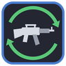

# Gun Poser: aim and move the gun in your hand in VR, per gun

A small desktop window for VR gun handling. It follows the gun in the right hand and shows six sliders for that gun:
aim it up or down, left or right, roll it, and move it forward, up or sideways in the hand. Move a slider and the gun
moves in the game at once. It sets the gun in hand only; tick **ALL GUNS** to set the numbers every gun starts from.

**For now it works with one game: Visceral RE8 (Resident Evil Village VR).** The idea is to make it work across many
games as we mod them.

Made 2026-10-28 for tuning the gun inside the headset: Window View hangs this window in VR, the same way as its sister
apps [Grip Zones](https://github.com/TefMeister/grip-zones-vr) and [Hand Poser](https://github.com/TefMeister/hand-poser-vr).
It writes the same numbers as Grip Zones' "the gun in the right hand" entry, so the two windows always agree.

**Still being worked on:** built and tried on a test folder (2026-10-28), not yet tried in the headset. It will be tweaked as we go.

## Get it

Download the zip from [Releases](https://github.com/TefMeister/gun-poser-vr/releases), unzip it, right-click
`install.ps1` and choose **Run with PowerShell**. A **Gun Poser** icon appears on the desktop; no administrator rights
are needed. The game half (the script that moves the gun) is part of Visceral RE8 itself; without it the window opens
but has nothing to move.

Or build it yourself: `build.bat` (only the C# compiler that ships with Windows), then `install.ps1`.

## Credits

Part of the helper apps made with Visceral RE8; the window parts come from Grip Zones (see `shared/`).
If someone should be credited here and is not, please open an issue and we will fix it as soon as possible.

## Licence

MIT for everything in this repository that we wrote.
